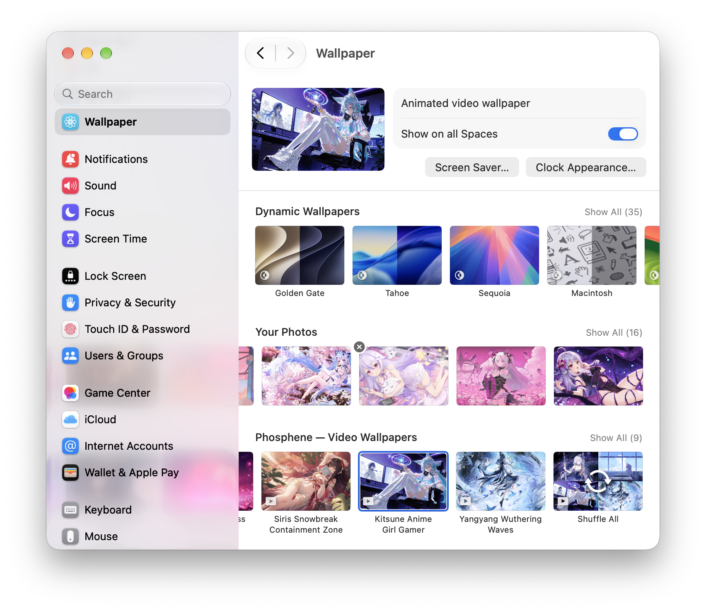

# Phosphene

[English](README.md) · [简体中文](README.zh-CN.md)

Phosphene adds your videos to System Settings → Wallpaper through the same wallpaper pipeline as Apple’s Aerials. macOS plays them on the desktop and lock screen, even after you quit the app. It also turns **Wallpaper Engine** wallpapers from the Steam Workshop into video wallpapers.

The download above is the upstream release. To try the pairing and conversion tools in this fork, [build from source](CONTRIBUTING.md#build).

## Highlights

- Use Wallpaper Engine wallpapers from the Steam Workshop: subscribe in Steam, and Phosphene makes a looping video of each.
- Pair two videos into one wallpaper that follows your Mac’s light or dark appearance. [Create a light/dark pair](#lightdark-wallpaper-pairs).
- Play HDR video with bright or subdued highlights, or export an SDR copy. [HDR and SDR](#hdr-and-sdr).
- Keep desktop and lock-screen playback running after quitting Phosphene.
- Pause playback under covered desktops and adjust decoding to power and thermal conditions.

Full feature list

- Import videos in the **Library** window and select them in **System Settings → Wallpaper**.
- Wallpaper selection per display or Space, plus a **Lock Screen**-only playback mode.
- Desktop and lock-screen playback through the macOS wallpaper pipeline.
- MP4, MOV, and other AVFoundation-readable inputs; gapless looping and lock/unlock transitions.
- Menu-bar preview, pause, display switching, and launch at login.
- **Restart Wallpaper Agent** from the menu bar for stuck playback.
- A **Wallpaper Engine** section: Steam Workshop downloads from Sevoflurane, CrossOver or Whisky become looping videos.

## Light/dark wallpaper pairs

A pair appears as one item in both the Library and macOS Wallpaper settings. For example, you can use two renders of the same scene, one lit for day and one for night. Changing appearance switches the video at the current point in the animation.

1. Import both videos. In **Library → All Videos**, select them together and choose **Pair…**.
2. Check that the preview shows the light video on the left and the dark video on the right. Swap the assignments if needed, then choose **Create Pair**. Direct pairing uses the two existing files without re-encoding them.
3. In **System Settings → Wallpaper**, select the pair. **Automatic** follows the Mac’s appearance. Choose **Light** or **Dark** to keep that version even when the system appearance changes.

Direct pairing needs matching dimensions, orientation, constant frame rate, frame count, duration, and encoding (including color format). Both videos need a shared keyframe at the start and at least every half second. The **?** button lists the export requirements.

If the videos don’t match, **Open Pair Converter…** carries both files and their light/dark assignments into **Tools → Light/Dark Pair Converter…**. Choose a common resolution, frame rate, and color format. The converter aligns keyframes, uses the shorter clip’s duration, and adds the new pair to the Library.

You can find pairs under **Light/Dark Pairs** in the Library. **Split Pair…** returns both members to the Library as separate videos. For a moving scene, the optional **Settings → Playback → Blend Matching Frames** blends frames with the same timestamp during an appearance change. This briefly increases GPU and memory use, especially with high-frame-rate HDR video.

## HDR and SDR

**Phosphene → Settings → Playback → Dynamic Range** controls how macOS displays video highlights in the wallpaper and its previews. This preference applies at playback time. A pair’s **Light** and **Dark** settings select which video plays. For example, a night scene can still use HDR for bright stars.

| Playback setting | Effect on HDR video |
| --- | --- |
| Automatic (default) | Lets macOS choose the display range. |
| Standard | Displays the video within the SDR brightness range. |
| Constrained High | Allows HDR highlights but keeps them more subdued alongside desktop windows. |
| High | Requests the full HDR range currently available on the display. |

Visible highlights depend on both the source video and the display’s available brightness above SDR white. [Apple’s guide to HDR rendering](https://developer.apple.com/documentation/coregraphics/adopting-advancements-in-hdr-image-rendering).

### Encoding a video

- **Optimize** creates lower-power playback versions of a single video or a pair and keeps the originals. Phosphene can select one of these copies as power and thermal conditions change. Supported HLG and PQ sources retain HDR by default. To make SDR copies, enable **Convert to SDR** before choosing a preset.
- **Tools → Custom Conversion…** takes a Library video or an external file. Choose **SDR · Rec. 709**, **HDR · HLG**, or **HDR · PQ** as the output. The pair converter offers the same targets for both videos. HDR output uses 10-bit HEVC. Converting HDR to SDR maps bright highlights into the SDR range. An SDR-to-HDR export can only preserve the highlight detail present in the source.

## Wallpaper Engine

The Steam Workshop has hundreds of thousands of animated wallpapers made for Wallpaper Engine, a Windows program. Phosphene turns them into video wallpapers: subscribe in Steam, pick them in the library's Wallpaper Engine section, and choose Make Videos.

Wallpaper Engine runs in Windows Steam. [Sevoflurane](https://kagerou.glass/sevoflurane/?from=phosphene-readme) brings that Steam to your Mac, free, from the same developer. What a video keeps and what it leaves out: [WALLPAPER-ENGINE.md](WALLPAPER-ENGINE.md).

Wallpaper Engine is a trademark of Wallpaper Engine Team; Steam is a trademark of Valve Corporation. Phosphene is an independent app.

## Privacy

Choose **Count Me In** in the menu bar to enable anonymous usage statistics. You can change either option independently in **Settings → Privacy**. Both start off.

- **Send crash reports** sends the app's crash log and basic system details after a Phosphene crash. Account names, Mac names, and home folder paths are redacted before upload.
- **Count this Mac** sends one anonymous check-in per day of use. It includes the date, app and macOS versions, chip, memory, language, display count, days active in the last week, and whether you imported videos. Video names and files are excluded.

Turning both options off requests deletion of this Mac's submissions. Offline deletion requests retry when the service becomes available. [Digoxin field reference](https://github.com/kageroumado/digoxin/blob/main/REFERENCE.md).

## Notes

- macOS 26+ · Apple silicon or Intel.
- Homebrew: `brew install --cask phosphene`.
- Uses private `WallpaperExtensionKit` APIs, which macOS updates can change. [Troubleshooting and implementation](REFERENCE.md).
