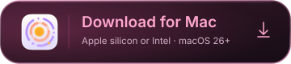

# Phosphene

[English](README.md) · [简体中文](README.zh-CN.md)

Phosphene adds your videos to System Settings → Wallpaper through the same wallpaper pipeline as Apple’s Aerials. macOS plays them on the desktop and lock screen, even after you quit the app. It also turns **Wallpaper Engine** wallpapers from the Steam Workshop into video wallpapers.

## Highlights

- Use Wallpaper Engine wallpapers from the Steam Workshop: subscribe in Steam, and Phosphene makes a looping video of each.
- Select personal videos alongside Apple’s wallpapers in System Settings.
- Keep desktop and lock-screen playback running after quitting Phosphene.
- Pause playback under covered desktops and adjust decoding to power and thermal conditions.

Full feature list

- Import videos in the **Library** window and select them in **System Settings → Wallpaper**.
- Wallpaper selection per display or Space, plus a **Lock Screen**-only playback mode.
- Desktop and lock-screen playback through the macOS wallpaper pipeline.
- MP4, MOV, and other AVFoundation-readable inputs; gapless looping and lock/unlock transitions.
- Menu-bar preview, pause, display switching, and launch at login.
- Visibility, power, and thermal-aware playback; optional lower-resolution variants.
- **Restart Wallpaper Agent** from the menu bar for stuck playback.
- A **Wallpaper Engine** section: Steam Workshop downloads from Sevoflurane, CrossOver or Whisky become looping videos.

## Light and dark wallpapers

Select two videos in the Library to create a light/dark pair. Compatible videos keep their original files. The pair converter can give two clips matching dimensions, frame timing, color format, and keyframes. The resulting pair appears as one choice in System Settings → Wallpaper. **Automatic** follows the Mac’s appearance, while **Light** and **Dark** pin the selected version. Splitting a pair restores the two individual Library entries.

HDR playback supports HLG and PQ. **Dynamic Range** controls highlight brightness at playback time. When creating optimized versions, **Convert to SDR** tone-maps the output to Rec. 709 and keeps the HDR original.

Open **Tools → Custom Conversion…** to convert a single clip, or **Tools → Light/Dark Pair Converter…** to create a matched pair. Playback settings are in **Settings → Playback**.

## Wallpaper Engine

The Steam Workshop has hundreds of thousands of animated wallpapers made for Wallpaper Engine, a Windows program. Phosphene turns them into video wallpapers: subscribe in Steam, pick them in the library's Wallpaper Engine section, and choose Make Videos.

Wallpaper Engine runs in Windows Steam. [Sevoflurane](https://kagerou.glass/sevoflurane/?from=phosphene-readme) brings that Steam to your Mac, free, from the same developer. What a video keeps and what it leaves out: [WALLPAPER-ENGINE.md](WALLPAPER-ENGINE.md).

Wallpaper Engine is a trademark of Wallpaper Engine Team; Steam is a trademark of Valve Corporation. Phosphene is an independent app.

## Counting

The menu bar asks once whether to count this Mac. In **Settings → Privacy**, **Count this Mac** and **Send crash reports** are separate opt-in choices.

- **Count this Mac** sends one anonymous check-in per day of use. It includes the Phosphene and macOS versions, chip family, memory size, language, date, days active in the last week, display count, and whether you imported videos. It does not include which videos you use.
- **Send crash reports** sends a scrubbed report when Phosphene itself crashes, with the account name, Mac name, and home folder path redacted.

Turning off either choice clears its queue and requests deletion of data sent under its separate registration. Crash reports already sent under the former combined setting share the usage registration. Turning off **Count this Mac** requests deletion of that older data. See the [Digoxin reference](https://github.com/kageroumado/digoxin/blob/main/REFERENCE.md) for the fields sent.

## Notes

- macOS 26+ · Apple silicon or Intel.
- Homebrew: `brew install --cask phosphene`.
- Uses private `WallpaperExtensionKit` APIs, which macOS updates can change. [Troubleshooting and implementation](REFERENCE.md).
