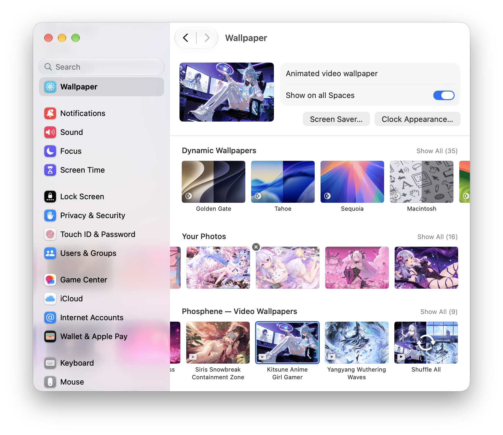

# Phosphene

[English](README.md) · [简体中文](README.zh-CN.md)

Phosphene adds your videos to System Settings → Wallpaper through the same wallpaper pipeline as Apple’s Aerials. macOS plays them on the desktop and lock screen, even after you quit the app.

## Highlights

- Select personal videos alongside Apple’s wallpapers in System Settings.
- Keep desktop and lock-screen playback running after quitting Phosphene.
- Pause playback under covered desktops and adjust decoding to power and thermal conditions.

Full feature list

- Import videos through **Manage Library** and select them in **System Settings → Wallpaper**.
- Wallpaper selection per display or Space, plus **Only on Lock Screen**.
- Desktop and lock-screen playback through the macOS wallpaper pipeline.
- MP4, MOV, and other AVFoundation-readable inputs; gapless looping and lock/unlock transitions.
- Menu-bar preview, pause, display switching, and launch at login.
- Visibility, power, and thermal-aware playback; optional lower-resolution variants.
- **Restart Wallpaper Agent** from the menu bar for stuck playback.

## Notes

- macOS 26+ · Apple silicon or Intel.
- Homebrew: `brew install --cask phosphene`.
- Uses private `WallpaperExtensionKit` APIs, which macOS updates can change. [Troubleshooting and implementation](REFERENCE.md).
