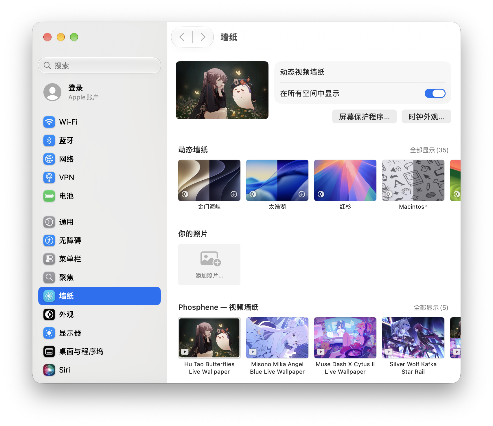
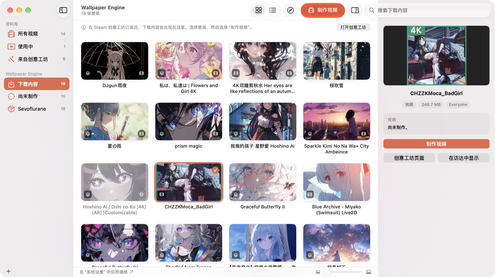

# Phosphene

[English](README.md) · [简体中文](README.zh-CN.md)

Phosphene 通过与 Apple 航拍墙纸相同的墙纸管线，把你的视频添加到“系统设置”→“墙纸”。macOS 会在桌面和锁定屏幕上播放它们，即使退出 App 之后也一样。它还能把 Steam 创意工坊里的 **Wallpaper Engine** 壁纸变成视频墙纸。

## 特色

- 使用 Steam 创意工坊里的 Wallpaper Engine 壁纸：在 Steam 里订阅，Phosphene 为每一张做出循环视频。
- 在“系统设置”中，与 Apple 自带墙纸并列选择个人视频。
- 退出 Phosphene 后，桌面和锁定屏幕继续播放。
- 桌面被遮挡时暂停播放，并根据电源和温度状况调整解码。

完整功能

- 通过**资料库**导入视频，在**“系统设置”→“墙纸”**中选择。
- 将同一动画的浅色和深色版本配对后，两段视频会显示为一张墙纸。在墙纸设置中选择**自动**即可跟随系统外观，也可以固定为**浅色**或**深色**。
- 可按显示器或空间分别选择墙纸，也可**仅在锁定屏幕**播放。
- 桌面和锁定屏幕播放均通过 macOS 墙纸管线完成。
- 支持 MP4、MOV 及其他 AVFoundation 可读取的格式；无缝循环，锁定与解锁平滑过渡。
- 菜单栏预览、暂停、显示器切换，以及登录时打开。
- **优化**可为单个视频或明暗配对生成低功耗版本。HLG 和 PQ 视频默认保留 HDR；需要 SDR 时，先勾选**转换为 SDR**，再选择预设。资料库保留原片。
- **工具 → 自定义转换**可将资料库视频或外部文件导出为 SDR、HLG 或 PQ。**明暗配对转换工具**会将两段视频转换为相同的尺寸、帧率、时长和色彩格式，校验通过后作为一个配对添加到资料库。
- 在 Phosphene 的**设置 → 播放 → 动态范围**中调整墙纸和资料库预览。选择**受限高动态范围**可降低高光亮度，选择**自动**可恢复系统默认设置。
- 墙纸卡住时，从菜单栏**重新启动墙纸代理**。
- **Wallpaper Engine** 分区：Sevoflurane、CrossOver 或 Whisky 里的 Steam 创意工坊下载，变成循环视频。

## Wallpaper Engine

Steam 创意工坊里有几十万张为 Wallpaper Engine 制作的动态壁纸，而它是一个 Windows 程序。Phosphene 把它们变成视频墙纸：在 Steam 里订阅，在资料库的 Wallpaper Engine 分区里选中，然后点“制作视频”。

Wallpaper Engine 在 Windows 版 Steam 里运行。[Sevoflurane](https://kagerou.glass/sevoflurane/zh-CN/?from=phosphene-readme) 能把这个 Steam 带到 Mac 上，免费，出自同一位开发者。视频保留什么、省略什么：[WALLPAPER-ENGINE.md](WALLPAPER-ENGINE.md)。

Wallpaper Engine 是 Wallpaper Engine Team 的商标；Steam 是 Valve Corporation 的商标。Phosphene 是独立开发的 App。

## 隐私

在菜单栏选择**算我一个**即可开启匿名使用统计。你也可以在**设置 → 隐私**中分别更改以下两项，默认均关闭。

- **发送崩溃报告**会在 Phosphene 崩溃后发送崩溃日志及基本系统信息。上传前会隐去账户名称、Mac 名称和个人文件夹路径。
- **统计这台 Mac** 会在使用当天发送一次匿名签到，包括日期、App 与 macOS 版本、芯片、内存、语言、显示器数量、过去一周的使用天数，以及是否导入过视频。视频名称和文件均不在统计范围内。

关闭两项设置会请求删除这台 Mac 已发送的数据。如果服务暂时不可用，App 会重试。[Digoxin 字段说明（英文）](https://github.com/kageroumado/digoxin/blob/main/REFERENCE.md)。

## 其他信息

- macOS 26+ · Apple 芯片或 Intel。
- Homebrew：`brew install --cask phosphene`。
- 使用私有的 `WallpaperExtensionKit` API，macOS 更新可能改变其行为。[故障排除与实现细节](REFERENCE.md)（英文）。
