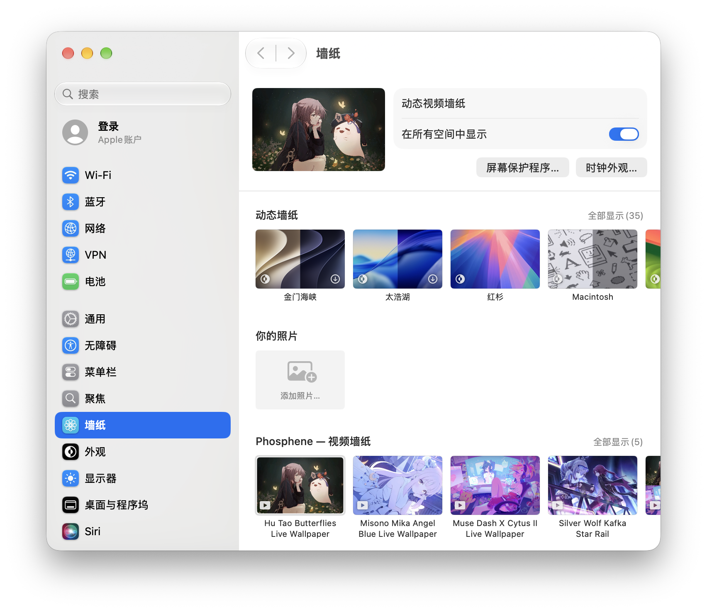

# Phosphene

[English](README.md) · [简体中文](README.zh-CN.md)

Phosphene 通过与 Apple 航拍墙纸相同的墙纸管线，把你的视频添加到“系统设置”→“墙纸”。macOS 会在桌面和锁定屏幕上播放它们，即使退出 App 之后也一样。

## 特色

- 在“系统设置”中，与 Apple 自带墙纸并列选择个人视频。
- 退出 Phosphene 后，桌面和锁定屏幕继续播放。
- 桌面被遮挡时暂停播放，并根据电源和温度状况调整解码。

完整功能

- 通过**资料库**导入视频，在**“系统设置”→“墙纸”**中选择。
- 可按显示器或空间分别选择墙纸，也可**仅在锁定屏幕**播放。
- 桌面和锁定屏幕播放均通过 macOS 墙纸管线完成。
- 支持 MP4、MOV 及其他 AVFoundation 可读取的格式；无缝循环，锁定与解锁平滑过渡。
- 菜单栏预览、暂停、显示器切换，以及登录时打开。
- 根据可见性、电源和温度调整播放；可选生成低分辨率版本。
- 墙纸卡住时，从菜单栏**重新启动墙纸代理**。

## 其他信息

- macOS 26+ · Apple 芯片或 Intel。
- Homebrew：`brew install --cask phosphene`。
- 使用私有的 `WallpaperExtensionKit` API，macOS 更新可能改变其行为。[故障排除与实现细节](REFERENCE.md)（英文）。
